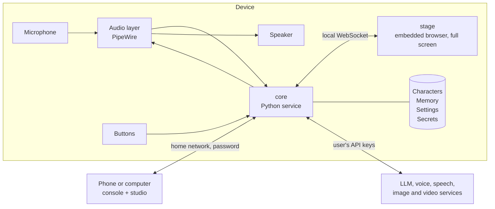

# System architecture

Status: proposal, 2026-11-16. Awaiting the owner's agreement before the bulk
of the code is written.

## Names used in this document

| Name | Meaning |
|---|---|
| **core** | The device service: conversation, providers, characters, memory, settings, web API |
| **stage** | The full-screen page on the device's own screen that draws the character |
| **console** | The web UI the owner opens from a phone or computer to manage the device |
| **studio** | The part of the console that turns an image into a character |
| **character package** | One file holding everything that defines a character |

## Shape of the system



Two programs run on the device, supervised separately:

1. **core** — one Python process. It owns audio, the conversation, all
   network calls, all stored data, and serves the web pages.
2. **stage** — an embedded browser in kiosk mode showing one local page. It
   only draws. It holds no keys and makes no calls to outside services.

They are separate so that a crash in drawing cannot take down the
conversation and the reverse, and so the drawing side can be replaced (for
example by microcontroller firmware) without touching the rest.

## Why these technologies

| Choice | Reason | Rejected |
|---|---|---|
| Web page for the character (plain JavaScript, canvas and WebGL) | The same drawing code runs on the device, in the console's live preview on a phone, and in automated tests here. No separate preview renderer to write. | A native renderer in Rust or C++ (leaner, but twice the work and no shared preview); Godot (no route for generated rigs); a video player alone (cannot draw the puppet) |
| WPE embedded browser inside the `cage` kiosk server | About half the memory of Chromium; made for kiosks; both are standard Debian packages | Chromium as default (kept as fallback: better debugging, more memory) |
| Python with a small dependency set | Fast to write and test; the heavy work happens in native libraries or in the cloud | Pipecat (see technology research); Go or Rust for the service (slower to iterate, no payoff at this load) |
| No build step for the web code | Nothing to compile on the device; what is in the repository is what runs | Bundled TypeScript (adds a toolchain to pin and maintain) |
| USB audio | Works on any board with no driver or device-tree work; one plug to replace | Audio boards on the header pins (cheaper by a few dollars, tied to one board family) |
| Raspberry Pi OS Lite, 64-bit, Debian 13 base | Long support, first-party drivers for the chosen screen | A custom-built minimal Linux (faster boot, much more work; a later optimisation) |

## Conversation data flow

Standard path, one user turn:

1. **Capture.** Microphone audio arrives as 16 kHz mono in 20 ms frames.
   With the ReSpeaker Lite the echo of the character's own voice has already
   been removed.
2. **Activation.** The listen button opens a listening session. In
   conversation mode it stays open across turns; in press-to-talk mode a
   second press ends the user's turn.
3. **Voice activity.** A small on-device detector marks where speech starts
   and stops. End of turn is declared after a configurable pause.
4. **Speech recognition.** Audio is recognised as it arrives. With a
   streaming recogniser the text is ready within about 0.1–0.2 s of the end of
   speech; with a non-streaming service the finished utterance is uploaded.
5. **Context.** The turn manager assembles: the character's persona, the
   long-term memory summary, pinned facts, recent turns, and the current time.
6. **LLM.** The reply is requested as a stream.
7. **Response processing.** As text arrives it is split at sentence
   boundaries. Emotion markers the persona is instructed to emit (for example
   `[happy]`) are removed from the spoken text and sent to the stage. Markup
   and emoji are stripped.
8. **Voice.** Each sentence goes to the voice service as soon as it is
   complete; audio is requested as a stream.
9. **Playback and lip movement.** Audio plays as it arrives. The player
   measures loudness every 20 ms and sends it to the stage, timed to when that
   audio is actually heard, so the mouth moves with the voice.
10. **Memory.** The turn is appended to the character's history. When history
    grows past a threshold, older turns are folded into the summary by a
    background LLM call.

```
mic → voice activity → speech recognition → context → LLM (stream)
    → sentence splitter → voice (stream) → player → speaker
                                              └→ loudness + emotion → stage
```

### Latency

Target: the character starts speaking within about 1.2–1.8 s of the user
finishing, on a good connection. Where the time goes:

| Step | Typical |
|---|---|
| Pause that confirms the user has finished | 0.5 s |
| Recognition finalising | 0.1–0.2 s |
| LLM first words | 0.3–0.6 s |
| First sentence complete | 0.1–0.3 s |
| Voice service first audio | 0.1–0.3 s |

Measures: recognise while the user is still speaking; keep connections to
the LLM and voice services open between turns; send the first clause to the
voice service without waiting for the whole reply; show a "thinking" pose so
the gap reads as intent. The end-of-speech pause is the largest single item
and is adjustable in the console.

### Speech-to-speech mode

The conversation engine has one interface and two implementations: the
cascaded path above, and a realtime engine that holds a WebSocket to a
speech-to-speech service. Both produce the same events (transcripts, reply
text, audio, emotion, end of turn), so the stage, memory and console do not
care which is running. Selected per character. It uses the provider's own
voices, so a character with a cloned voice uses the cascaded path.

### Interruption

If the listen button is pressed while the character is speaking, or speech is
detected and echo cancellation is present:

1. The LLM stream and voice stream are cancelled.
2. Queued audio is dropped with a short fade.
3. The stored reply is cut back to what was actually spoken, so the
   character's memory matches what the user heard.
4. Listening starts immediately.

### Failure handling

| Failure | Behaviour |
|---|---|
| No network at start-up | Character appears with an "offline" marker; core keeps retrying. If no Wi-Fi has ever been set up, setup mode starts. |
| Service timeout (recognition 8 s, LLM first words 10 s, voice first audio 6 s) | One retry, then the next configured provider if any, then a short pre-recorded spoken notice and an on-screen message. |
| Rate limit or server error | Back off, honouring the service's retry hint; same fallback chain. |
| Invalid API key | No retry. On-screen message naming which key, and a console alert. |
| Voice service fails mid-reply | Remaining text is shown as a caption. |
| Corrupt character package | Rejected on import with a reason. If the active character fails to load, the built-in reference character is used and the console shows why. |
| Stage crash or freeze | Restarted by the supervisor; core keeps running. Stage reports a heartbeat; three missed beats trigger a restart. |
| Core crash | Restarted by the supervisor; stage shows "reconnecting" and resumes. |
| Audio device unplugged or changed | Detected by the audio layer; core reopens streams and reports the state. |
| Screen disconnected and reconnected | The kiosk server restarts the stage on the new output. |
| Whole device hang | Hardware watchdog reboots it. |

Pre-recorded notices are used for failures because a spoken error cannot
depend on the service that just failed.

## Providers

Adapters are written per protocol, not per company. Adding a company that
speaks an existing protocol is a settings entry.

| Role | Adapters in the first release | Later |
|---|---|---|
| LLM | OpenAI-compatible chat (covers OpenAI, OpenRouter, Groq, Gemini's compatible endpoint, local servers); Anthropic | — |
| Speech recognition | On-device sherpa-onnx; OpenAI-compatible transcription (OpenAI, Groq, self-hosted) | Deepgram streaming |
| Voice | OpenAI-compatible speech; ElevenLabs | Cartesia, Fish Audio; a configurable generic HTTP adapter |
| Speech-to-speech | — | OpenAI Realtime, Gemini Live |
| Image and video (studio) | — | One image-editing and one image-to-video adapter |

Each adapter declares what it supports (streaming, cloning, voices list) so
the console only offers valid combinations. Each has a "test" action in the
console.

## Character package

One zip file with the extension `.char`.

```
manifest.json     format version, id, name, author, licence note, kind
persona.md        system prompt, greeting, speaking style
voice.json        preferred voice per provider type; no credentials
voice/sample.wav  optional sample for cloning
behaviour.json    emotion names, idle behaviour, end-of-speech pause override
visual/           depends on kind:
  sprite.json + frames/*.webp     still frames per emotion and mouth level
  clips.json  + clips/*.mp4       loops per state and emotion
  puppet.json + textures/*.webp   meshes, parameters, deformers
ui/               optional background and colours
preview.webp
```

Rules:

- **Never contains** API keys or memories. Memories are exported separately,
  only when the owner asks.
- A package may *suggest* providers and voices; the device decides.
- A cloned voice lives in the owner's account at the voice provider. The
  device keeps a private table linking each character to that voice.
- Import is validated before anything is stored: structure, sizes, image
  dimensions, file types, and file paths that try to escape the package.
  Nothing in a package is ever executed.
- Clips are converted on import to the format the device plays best, so
  packages stay portable between device types.
- A character can be made from a single image: the studio builds the
  package.

All three kinds present the same four controls to the rest of the system:
state (idle, listening, thinking, speaking), emotion, mouth openness, and
time. The conversation side never knows which kind is on screen.

## Stored data

| Data | Location | Protection |
|---|---|---|
| Characters | Data partition | Validated on import |
| Memory per character: summary, pinned facts, turn history | Data partition | Readable and editable in the console; export and delete per character |
| Settings | Data partition | Written atomically so a power cut cannot corrupt them |
| API keys | Separate file readable only by the core service | Write-only in the console (shown as last four characters); masked in all logs; excluded from every export and backup |
| Logs | Journal, size-capped | Rotated automatically |

The operating system partition is mounted read-only with a memory overlay, so
pulling the plug cannot damage it. Only the data partition is writable.

Encrypting keys on a device with no secure element would only move the
problem, since the decryption key would sit beside them. File permissions,
masking and exclusion from exports are the real protections, and the manual
should say so plainly.

## Console and security

- Reached at `http://<device-name>.local/` or by scanning a QR code shown on
  the device screen.
- Password set at first use; stored only as a salted hash. Login attempts are
  rate limited. Session cookie is not readable by scripts; state-changing
  requests carry an anti-forgery token.
- Listens on the home network only. The stage's control channel listens only
  inside the device.
- Functions: characters (upload by drag-and-drop, choose, delete, export),
  studio, providers and keys with test buttons, memory viewer and editor,
  microphone and speaker test, Wi-Fi, logs and status, restart, update,
  common settings.
- USB stick import: a stick containing `.char` files is detected and its
  characters offered for import on the next console visit, or imported
  automatically if that setting is on.

## Wi-Fi setup

If the device has no saved network, or the listen button is held for ten
seconds, it starts its own temporary hotspot and shows two QR codes: one to
join the hotspot, one to open the setup page. The owner picks their network
and enters its password; the device joins it, stops the hotspot and shows the
console address.

## Appliance behaviour

| Concern | Design |
|---|---|
| Start-up | Quiet boot with a splash image, then the stage's own loading animation. No text console, desktop or login is shown. |
| Autostart | Two supervised services, core and stage, started at boot and restarted on failure with back-off. Stage waits for core; core does not wait for the network. |
| Buttons | Listen: short press toggles listening or interrupts; hold 3 s mutes the microphone; hold 10 s enters setup mode. Power: press to shut down cleanly, press again to start. |
| Unplugging | Safe at any time because the system partition is read-only. |
| Updates | Started from the console: upload a release file or fetch the latest release. Installed alongside the running version; after restart a health check must pass, otherwise the previous version is restored automatically. |
| Operating system | Packages pinned to the versions the release was tested with. No unattended upgrades. |
| Reproducibility | Python dependencies locked with hashes. A script builds a ready-to-flash image, so a buyer's unit and a rebuild six months later are identical. |

## Testing approach

| Layer | Method | Where |
|---|---|---|
| Package validation, memory, settings, secrets masking | Unit tests | Here |
| Conversation pipeline, interruption, timeouts, retries, fallbacks | Tests against fake provider servers that can be told to stall, fail or rate-limit | Here |
| Console and stage | Browser automation with screenshots | Here |
| Whole device software without hardware | A "virtual device" mode that runs core and opens the stage in a normal browser, using the computer's microphone and speakers | Here and on the owner's computer |
| Screen, audio, buttons, boot, power loss, Wi-Fi setup, heat | Written procedure with expected results | Owner, on the prototype |

The virtual device means the owner can try characters and providers on a
laptop before any parts arrive.

## Build order

| Step | Content | Result |
|---|---|---|
| 1 | Core skeleton, character package and validator, sprite and clip drawing, stage, console basics, cascaded conversation with first adapters, memory, an original reference character, tests | Works as a virtual device on a computer |
| 2 | Installer, services, kiosk, Wi-Fi setup, buttons, splash, read-only system, update with rollback, image build, build guide, hardware test procedure | Works as an appliance on the prototype |
| 3 | Puppet runtime, studio: sprite and clip generation, single-image puppet version 0 | Standard tier; characters from one image |
| 4 | Speech-to-speech engine, more adapters, layered puppet import, cost reduction including the microcontroller Lite study | Refinement |

## Open risks

1. Memory on a 1 GB board is estimated, not measured.
2. Smooth cross-fading between two video clips in the embedded browser on the
   Pi 4 is unproven. The fallback is a hard cut on the shared anchor frame.
3. Single-image puppets depend on locating facial features accurately; the
   manual correction step in the studio is the safety net.
4. Clip characters depend on image-to-video services honouring a matching
   first and last frame. This needs testing with real services and money.
5. Boot time on Linux will not approach a microcontroller's. Trimming can
   reach perhaps 15 s; the owner ranks boot speed second.
