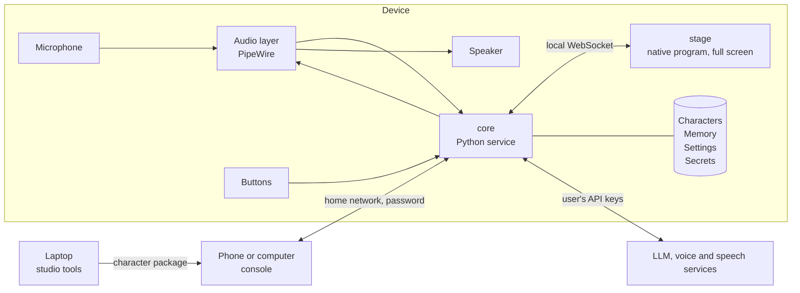

# System architecture

Status: revision 2, 2026-11-16. Updated after the owner's review and the
Inochi2D test (`07-spike-inochi2d.md`).

Changes from revision 1: the Standard puppet uses the Inochi2D format; the
character is drawn by a small native program instead of a web browser;
provider speech-to-speech services are dropped; character creation for the
Standard tier is a laptop tool chain; Standard is built first.

## Names used in this document

| Name | Meaning |
|---|---|
| **core** | The device service: conversation, providers, characters, memory, settings, web API |
| **stage** | The full-screen program on the device's own screen that draws the character |
| **console** | The web UI the owner opens from a phone or computer to manage the device |
| **studio** | The tools that turn an image into a character |
| **character package** | One file holding everything that defines a character |

## Shape of the system



Two programs run on the device, supervised separately:

1. **core** — one Python process. It owns audio, the conversation, all
   network calls, all stored data, and serves the console.
2. **stage** — one small native program. It only draws. It holds no keys and
   makes no calls to outside services.

They are separate so that a crash in drawing cannot take down the
conversation and the reverse, and so the drawing side can be replaced (for
example by microcontroller firmware for a later Lite) without touching the
rest.

## Why these technologies

| Choice | Reason | Rejected |
|---|---|---|
| Stage written in Rust, drawing through OpenGL ES | The Inochi2D renderer that works (Inox2D) is Rust. A native program needs tens of megabytes where a browser needs hundreds, starts in a fraction of the time, and does not depend on a browser agreeing to use the graphics chip of a lesser-known board. | A kiosk web browser as the stage (proposed in revision 1; kept only as a fallback); Godot; a bare video player |
| The same stage code also compiled to WebAssembly | Gives the console a live preview and lets the software run in a browser tab on a laptop before hardware exists. Proven in the test. | A second, separate preview renderer |
| Inochi2D puppet format, Inox2D runtime pinned to a known commit with our patches | Open, BSD-licensed, has a free rigging editor, and renders real rigged characters. See the test record. | Live2D; our own format (no editor, no existing models); waiting for Inochi2D 0.9 |
| `cage` as the display server | Smallest way to give one program the whole screen; standard Debian package | A desktop environment |
| Python with a small dependency set for core | Fast to write and test; heavy work happens in native libraries or in the cloud | Pipecat (too heavy for this device); Go or Rust for the service |
| Console as plain web pages, no build step | Nothing to compile on the device | A bundled front-end framework |
| USB audio | Works on any board with no driver work; one plug to replace | Audio boards on the header pins |
| Debian 13 base (Raspberry Pi OS or Armbian, depending on the board) | Long support; the same packages on every candidate board | A custom-built minimal Linux (faster boot, much more work; a later optimisation) |

## Character kinds

All kinds present the same four controls to the rest of the system: state
(idle, listening, thinking, speaking), emotion, mouth openness, and time. The
conversation side never knows which kind is on screen.

| Kind | Tier | What it is | How the mouth moves |
|---|---|---|---|
| Puppet | Standard | An Inochi2D puppet: layered art on meshes, bent by named parameters, with physics for hair and clothing | The mouth parameter follows the loudness of the voice; blinking, breathing and small head movement run continuously |
| Clips | Lite | Short pre-rendered loops per state and emotion | The speaking loop plays while audio is playing |
| Sprite | Lite | A few still frames per emotion: mouth closed, half open, open, and a blink | The frame is chosen from the loudness of the voice |

### How lip movement is timed

The device plays the voice audio itself, so it knows exactly which slice of
sound is leaving the speaker at each moment. Every 20 ms it measures the
loudness of the slice being played, smooths it slightly, and sends that
number to the stage: quiet means mouth closed, loud means mouth open. Because
the measurement is taken from the audio at the moment it is played, the mouth
stays in step with the voice whatever the network delay was. This follows
loudness, not individual speech sounds, which is how most anime and streaming
avatars are animated. Voice services that return timing for each character
of text allow a later upgrade to vowel-specific mouth shapes.

## Conversation data flow

One user turn:

1. **Capture.** Microphone audio arrives as 16 kHz mono in 20 ms frames.
   With an echo-cancelling audio board the character's own voice has already
   been removed.
2. **Activation.** The listen button opens a listening session. In
   conversation mode it stays open across turns; in press-to-talk mode a
   second press ends the user's turn.
3. **Voice activity.** A small on-device detector marks where speech starts
   and stops. End of turn is declared after a configurable pause.
4. **Speech recognition.** Audio is recognised as it arrives, on the device
   by default.
5. **Context.** The turn manager assembles: the character's persona, the
   long-term memory summary, pinned facts, recent turns, and the current time.
6. **LLM.** The reply is requested as a stream.
7. **Response processing.** As text arrives it is split at sentence
   boundaries. Emotion markers the persona is instructed to emit (for example
   `[happy]`) are removed from the spoken text and sent to the stage. Markup
   and emoji are stripped.
8. **Voice.** Each sentence goes to the voice service as soon as it is
   complete; audio is requested as a stream. This is where a cloned voice is
   used.
9. **Playback and lip movement.** Audio plays as it arrives, and loudness is
   sent to the stage as described above.
10. **Memory.** The turn is appended to the character's history. When history
    grows past a threshold, older turns are folded into the summary by a
    background LLM call.

```
mic → voice activity → speech recognition → context → LLM (stream)
    → sentence splitter → cloned-voice service (stream) → player → speaker
                                                    └→ loudness + emotion → stage
```

This is the "piece it together ourselves" form of speech-to-speech that the
owner described: every stage streams into the next, and the final stage is a
voice service that accepts cloned voices. Ready-made speech-to-speech
services are not used, because they speak only in their own voices.

### Latency

Target: the character starts speaking within about 1.2–1.8 s of the user
finishing, on a good connection. Where the time goes:

| Step | Typical |
|---|---|
| Pause that confirms the user has finished | 0.5 s |
| Recognition finalising | 0.1–0.2 s |
| LLM first words | 0.3–0.6 s |
| First sentence complete | 0.1–0.3 s |
| Voice service first audio | 0.1–0.3 s |

Measures: recognise while the user is still speaking; keep connections to
the LLM and voice services open between turns; send the first clause to the
voice service without waiting for the whole reply; show a "thinking" pose so
the gap reads as intent. The end-of-speech pause is the largest single item
and is adjustable in the console; press-to-talk mode removes it entirely,
because the second button press marks the end.

### Interruption

If the listen button is pressed while the character is speaking, or speech is
detected and echo cancellation is present:

1. The LLM stream and voice stream are cancelled.
2. Queued audio is dropped with a short fade.
3. The stored reply is cut back to what was actually spoken, so the
   character's memory matches what the user heard.
4. Listening starts immediately.

### Failure handling

| Failure | Behaviour |
|---|---|
| No network at start-up | Character appears with an "offline" marker; core keeps retrying. If no Wi-Fi has ever been set up, setup mode starts. |
| Service timeout (recognition 8 s, LLM first words 10 s, voice first audio 6 s) | One retry, then the next configured provider if any, then a short pre-recorded spoken notice and an on-screen message. |
| Rate limit or server error | Back off, honouring the service's retry hint; same fallback chain. |
| Invalid API key | No retry. On-screen message naming which key, and a console alert. |
| Voice service fails mid-reply | Remaining text is shown as a caption. |
| Corrupt character package | Rejected on import with a reason. If the active character fails to load, the built-in reference character is used and the console shows why. |
| Stage crash or freeze | Restarted by the supervisor; core keeps running. Stage reports a heartbeat; three missed beats trigger a restart. |
| Core crash | Restarted by the supervisor; stage shows "reconnecting" and resumes. |
| Audio device unplugged or changed | Detected by the audio layer; core reopens streams and reports the state. |
| Screen disconnected and reconnected | The display server restarts the stage on the new output. |
| Whole device hang | Hardware watchdog reboots it. |

Pre-recorded notices are used for failures because a spoken error cannot
depend on the service that just failed.

## Providers

Adapters are written per protocol, not per company. Adding a company that
speaks an existing protocol is a settings entry.

| Role | Adapters in the first release | Later |
|---|---|---|
| LLM | OpenAI-compatible chat (covers OpenAI, OpenRouter, Groq, Gemini's compatible endpoint, local servers); Anthropic | — |
| Speech recognition | On-device sherpa-onnx; OpenAI-compatible transcription (OpenAI, Groq, self-hosted) | Deepgram streaming |
| Voice | ElevenLabs (cloning); OpenAI-compatible speech | Cartesia and Fish Audio (both cloning); a configurable generic HTTP adapter |

Each adapter declares what it supports (streaming, cloning, voice list) so
the console only offers valid combinations. Each has a "test" action in the
console.

## Character package

One zip file with the extension `.char`.

```
manifest.json     format version, id, name, author, licence note, kind
persona.md        system prompt, greeting, speaking style
voice.json        preferred voice per provider type; no credentials
voice/sample.wav  optional sample for cloning
behaviour.json    emotion names, idle behaviour, end-of-speech pause override
visual/           depends on kind:
  puppet.inp  + puppet.map.json   Inochi2D puppet and parameter mapping
  clips.json  + clips/*           loops per state and emotion
  sprite.json + frames/*.webp     still frames per emotion and mouth level
ui/               optional background and colours
preview.webp
```

Rules:

- **Never contains** API keys or memories. Memories are exported separately,
  only when the owner asks.
- A package may *suggest* providers and voices; the device decides.
- A cloned voice lives in the owner's account at the voice provider. The
  device keeps a private table linking each character to that voice.
- Import is validated before anything is stored: structure, sizes, image
  dimensions, file types, and file paths that try to escape the package.
  Nothing in a package is ever executed.
- A bare `.inp` or `.inx` file can be uploaded on its own; the console wraps
  it in a package and asks for the persona and voice.
- Puppets that use features the runtime lacks (currently mesh groups) are
  refused with that reason rather than shown broken.
- Clips are converted on import to the frame format the stage plays.

## Creating characters

### Standard tier: from one image to a rigged puppet

This follows the chain of tools the owner proposed. The heavy step needs a
graphics card, so it runs on the user's laptop, not on the device.

| Step | Tool | Runs on | Output |
|---|---|---|---|
| 1. Split the image into layers | See-through (Apache-2.0) | Laptop with an 8–16 GB graphics card, about 2–3 minutes; or its free online demo, 1–2 images a day | A layered file with up to 23 named parts: front hair, back hair, face, irises, eye whites, eyelashes, eyebrows, mouth, ears, neck, clothing and so on |
| 2. Build a mesh for each layer | Our rigger, reusing Stretchy Studio's mesh generator (MIT) | Any browser | Triangle meshes fitted to each part |
| 3. Find the joints and face position | Pose detection as Stretchy Studio does it, with manual markers as the fallback | Any browser | Pivot points |
| 4. Apply a template rig | Our rigger | Any browser | The standard parameters (head turn and tilt, body sway, blink per eye, mouth, breathing) with generated mesh movements, plus physics on hair, tails and loose clothing |
| 5. Export | Our rigger | Any browser | An Inochi2D `.inp` file, uploaded to the device |

Because the output is a normal Inochi2D file, a result that needs touching
up can be opened in the free Inochi Creator editor, corrected and
re-exported. Users without a suitable laptop upload a hand-rigged `.inp`.

What is new work here is steps 4 and 5: no existing tool writes Inochi2D
files from a layered image. Stretchy Studio exports only to Spine and Live2D
project formats. Steps 1 to 3 reuse existing open-source code.

The honest limit: template rigs suit front-facing characters in a neutral
pose. Unusual poses, heavy overlap between parts, or props across the face
will need manual correction.

### Lite tier

Sprite and clip characters are generated from the console using the user's
own image or video AI key, or rendered from a rigged puppet in the studio so
that no paid service is needed.

## Stored data

| Data | Location | Protection |
|---|---|---|
| Characters | Data partition | Validated on import |
| Memory per character: summary, pinned facts, turn history | Data partition | Readable and editable in the console; export and delete per character |
| Settings | Data partition | Written atomically so a power cut cannot corrupt them |
| API keys | Separate file readable only by the core service | Write-only in the console (shown as last four characters); masked in all logs; excluded from every export and backup |
| Logs | Journal, size-capped | Rotated automatically |

The operating system partition is mounted read-only with a memory overlay, so
pulling the plug cannot damage it. Only the data partition is writable.

Encrypting keys on a device with no secure element would only move the
problem, since the decryption key would sit beside them. File permissions,
masking and exclusion from exports are the real protections, and the manual
should say so plainly.

## Console and security

- Reached at `http://<device-name>.local/` or by scanning a QR code shown on
  the device screen.
- Password set at first use; stored only as a salted hash. Login attempts are
  rate limited. Session cookie is not readable by scripts; state-changing
  requests carry an anti-forgery token.
- Listens on the home network only. The stage's control channel listens only
  inside the device.
- Functions: characters (upload by drag-and-drop, choose, delete, export),
  providers and keys with test buttons, voice cloning from a sample, memory
  viewer and editor, microphone and speaker test, Wi-Fi, logs and status,
  restart, update, common settings.
- USB stick or microSD import: `.char` and `.inp` files found on inserted
  media are offered for import.

## Wi-Fi setup

If the device has no saved network, or the listen button is held for ten
seconds, it starts its own temporary hotspot and shows two QR codes: one to
join the hotspot, one to open the setup page. The owner picks their network
and enters its password; the device joins it, stops the hotspot and shows the
console address. Whether hotspot mode works on each candidate board's Wi-Fi
chip is a hardware test item.

## Appliance behaviour

| Concern | Design |
|---|---|
| Start-up | Quiet boot with a splash image, then the stage's own loading animation. No text console, desktop or login is shown. |
| Autostart | Two supervised services, core and stage, started at boot and restarted on failure with back-off. Stage waits for core; core does not wait for the network. |
| Buttons | Listen: short press toggles listening or interrupts; hold 3 s mutes the microphone; hold 10 s enters setup mode. Power: press to shut down cleanly, press again to start. |
| Unplugging | Safe at any time because the system partition is read-only. |
| Updates | Started from the console: upload a release file or fetch the latest release. Installed alongside the running version; after restart a health check must pass, otherwise the previous version is restored automatically. |
| Operating system | Packages pinned to the versions the release was tested with. No unattended upgrades. |
| Reproducibility | Python dependencies locked with hashes; Rust dependencies locked; the stage is shipped as a pre-built program so nothing is compiled on the device. A script builds a ready-to-flash image. |

## Testing approach

| Layer | Method | Where |
|---|---|---|
| Package validation, memory, settings, secrets masking | Unit tests | Here |
| Conversation pipeline, interruption, timeouts, retries, fallbacks | Tests against fake provider servers that can be told to stall, fail or rate-limit | Here |
| Stage drawing | Run on a virtual display with software graphics and compare screenshots, as in the Inochi2D test | Here |
| Console | Browser automation with screenshots | Here |
| Whole device software without hardware | A "virtual device" mode: core on a computer, stage in a browser tab, using the computer's microphone and speakers | Here and on the owner's computer |
| Speed, screen, audio, buttons, boot, power loss, Wi-Fi setup, heat | Written procedure with expected results | Owner, on the prototype |
| Layer splitting with See-through | Needs a graphics card | Owner's laptop, or the online demo |

## Build order

Standard first, as agreed.

| Step | Content | Result |
|---|---|---|
| 1 | Core skeleton; character package and validator; stage drawing an Inochi2D puppet with live mouth, blink, breathing and idle movement; console basics; conversation pipeline with first adapters; memory; reference character; tests | Works as a virtual device on a computer |
| 2 | Installer, services, full-screen stage, Wi-Fi setup, buttons, splash, read-only system, update with rollback, image build, build guide, hardware test procedure | Works as an appliance on the prototype |
| 3 | Rigger: layered image to Inochi2D puppet; See-through instructions and launcher | Characters from one image |
| 4 | Sprite and clip kinds; more adapters; voice cloning from the console | Lite character kinds on the same hardware |
| 5 | Microcontroller Lite; cost reduction | Cheapest tier |

## Open risks

1. Puppet drawing speed on the prototype's graphics chip is unmeasured.
2. Template rigging quality across "most anime characters" is unproven until
   step 3 is tried on real images. Hand-rigged upload is the safety net.
3. Inox2D lacks mesh groups; some hand-rigged models will not load until
   that is added.
4. See-through's model weights were trained on commercial Live2D models and
   their licences have not been checked. It is run by the user, not shipped
   on the device, which limits exposure; it still needs a check before the
   studio is distributed.
5. Wi-Fi hotspot mode on non-Raspberry-Pi boards is unverified.
6. Boot time on Linux will not approach a microcontroller's.
