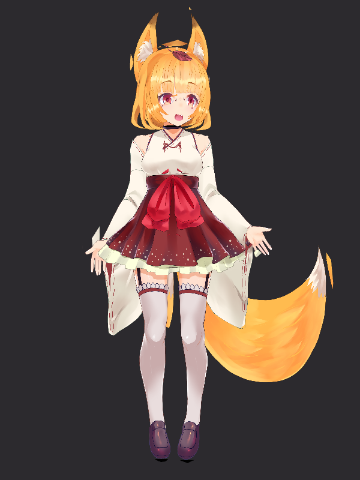

# Test: can Inochi2D run on a low-cost Linux board?

Date: 2026-11-16. Prompted by the owner's question after I rejected Inochi2D
on the strength of its README alone. That rejection was wrong. This records
what was actually built and run.

## Result

**Yes.** Inochi2D puppets load and render correctly on Linux, both as a
native program and inside a browser, using the Rust implementation (Inox2D).
Inochi2D is adopted as the Standard-tier puppet format.

| Test | Outcome |
|---|---|
| Inox2D native renderer, rigged sample model "Aka" | Renders correctly. No graphics errors. |
| Inox2D compiled to WebAssembly, same model, in headless Chromium | Renders correctly apart from a few stray edge fragments. |
| Official Inochi2D library (0.9 development), C interface | Builds from an August 2026 snapshot and loads the same model. The current source does not build. |


*Inox2D native OpenGL renderer drawing "Aka". Model design and rigging by
seagetch, licensed CC BY 4.0.*



*The same renderer compiled to WebAssembly, running in Chromium. Note the
small stray fragments beside the left ear and the tail.*

## What these tests do and do not prove

They were run on an x86 cloud machine with software graphics. They prove the
code builds, reads a real model and draws it correctly through the standard
graphics interfaces. They do **not** measure speed on an ARM board; the 15
frames per second seen in the browser test is software rendering and says
nothing about a real graphics chip. Speed has to be measured on the
prototype.

## The sample model

"Aka" is a complete hand-rigged character, the kind a user would upload:

| Property | Value |
|---|---|
| Parts (separate drawn layers) | 76 |
| Mesh | 3,427 vertices, 5,353 triangles |
| Parameters | 34 |
| Physics nodes (hair, sleeves, skirt, ears) | 19 |
| Textures | 76, about 16 MB in the file |
| File size | 17.7 MB |
| Parse time, native | about 0.1 s |

Its parameter names are the conventional ones, which the device can drive
directly:

| Device control | Inochi2D parameter |
|---|---|
| Mouth | `Mouth:: Shape` (two-axis) |
| Blink | `Eye:: Left:: Blink`, `Eye:: Right:: Blink` |
| Head movement | `Head:: Yaw-Pitch`, `Head:: Roll` |
| Body sway | `Body:: Yaw-Pitch`, `Body:: Roll` |
| Breathing | `Breath` |
| Hair, sleeves, skirt | Driven by the model's own physics |

Models that use other names get a mapping file, editable in the console.

## Findings about each implementation

### Inox2D (Rust) — chosen runtime

- BSD-2-Clause. Last commit 23 September 2026.
- One codebase produces a native program and a browser module.
- Its README still calls it a prototype. The gaps it lists are mesh groups
  and animation playback. Animation playback is not needed here because the
  device drives parameters live. Mesh groups are used by some newer models
  and would need to be added for those to load.
- Two defects found:
  1. The native example draws nothing until the window is resized, because
     its off-screen buffers start at zero size. One-line fix.
  2. In the browser, textures are set to a wrap mode WebGL does not have,
     which causes the stray edge fragments. Needs a small patch.
- This matches the owner's expectation: use the Inochi2D ecosystem and patch
  it where needed.

### Official Inochi2D library — not usable yet

- BSD-2-Clause. Under active rewrite for version 0.9 as a "bring your own
  renderer" library with a C interface, a WebAssembly build and TypeScript
  bindings.
- The current source has not compiled since 3 October 2026: a module was
  deleted while still referenced, part of an unfinished rewrite of the
  parameter system. The last snapshot that builds is from 1 August 2026.
- Its official PixiJS web renderer file is empty.
- It needs a newer D compiler (1.41 or later) than Debian 13 ships (1.40).
- The latest tagged release is still 0.8.7, which has a built-in renderer
  requiring desktop OpenGL 3.1. The open graphics drivers for the Mali chips
  on Orange Pi and Radxa boards do provide that, so 0.8 could also run
  there; this was not built.
- Position: track it. Once 0.9 is released it can replace Inox2D behind the
  same interface.

## Consequence for the design

Because the same renderer runs natively, the device no longer needs a web
browser to draw the character. A small native program uses far less memory
and starts faster than a browser, and avoids the risk of a browser refusing
to use the graphics chip on a lesser-known board. The browser build of the
same code is kept for the console's live preview and for trying the software
on a laptop.

## How to repeat the tests

Native:

```
git clone https://github.com/Inochi2D/inox2d      # tested at d4dd9dd
# examples/render-opengl/src/main.rs: use a non-zero initial size in
#   renderer.resize(...) inside resume_window
cargo build --release -p render-opengl
Xvfb :97 -screen 0 800x1000x24 &
DISPLAY=:97 LIBGL_ALWAYS_SOFTWARE=1 ./target/release/render-opengl Aka.inx
```

Browser:

```
rustup target add wasm32-unknown-unknown
cargo build --release --target wasm32-unknown-unknown -p render-webgl
cargo install wasm-bindgen-cli --version 0.2.130
wasm-bindgen --target web --out-dir web target/wasm32-unknown-unknown/release/render-webgl.wasm
# place the model at web/assets/puppet.inp, add a page with <canvas id="canvas">, serve and open
```

Official library (C interface), in a Debian environment with the D compiler
from Debian "forky" (1.42):

```
git clone https://github.com/Inochi2D/inochi2d && git checkout ec70226
dub build --config=dynamic --build=release
gcc -std=c23 examples/model-info/main.c -Iout/include -Lout -linochi2d -lm
```

The sample model is distributed through Git LFS in
`Inochi2D/example-models`.
